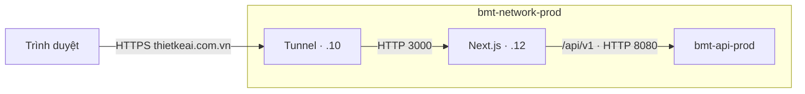

# Deploy BuildX AI

Push nhánh `develop` triển khai `dev` trên runner `linhdanhthue`; push nhánh
`main` triển khai `prod` trên runner `bmtdecor`. Có thể chạy thủ công workflow
**Deploy Application** trên một trong hai nhánh. Mỗi môi trường build image riêng
vì upstream API và biến công khai của Next.js được cố định lúc build.

## Quy trình

1. Kiểm tra type, lint, format, test chính sách auth và build ứng dụng.
2. Build Docker image trên `ubuntu-latest`, đăng nhập GHCR bằng `GITHUB_TOKEN`.
3. Push image `ghcr.io/<owner>/<repository>/buildx-fe-web:<environment>-<commit>`
   và cập nhật tag `<environment>-latest`.
4. Self-hosted runner pull tag của đúng commit vừa build, chạy Compose và chờ
   container vượt qua healthcheck tại `/vi`. Nếu healthcheck thất bại, job deploy
   thất bại; quy trình chưa tự rollback.

Các file chính:

| File                                        | Vai trò                                                  |
| ------------------------------------------- | -------------------------------------------------------- |
| `.github/workflows/main.yaml`               | Ghép quality → build → deploy cho `develop` và `main`    |
| `.github/workflows/quality.yaml`            | Kiểm tra PR và chặn deploy khi kiểm tra thất bại         |
| `.github/workflows/build-image.yaml`        | Build/push image bằng biến của GitHub Environment        |
| `.github/workflows/deploy-application.yaml` | Pull và chạy image trên self-hosted runner               |
| `Dockerfile`                                | Build Next.js standalone, chạy bằng user không phải root |
| `.docker/compose.yaml`                      | Profile `dev`/`prod`, healthcheck và external network    |
| `.docker/compose.tunnel.prod.yaml`          | Stack độc lập chỉ có tunnel và network prod              |
| `.docker/sync-env-secrets.sh`               | Đồng bộ cấu hình từ file env lên GitHub                  |

## Biến môi trường ứng dụng

Tạo GitHub Environments **dev** và **prod**. Mỗi environment dùng các secret
cùng tên với biến ứng dụng, kể cả giá trị công khai, để giữ cách cấu hình của repo mẫu.

| Secret                        | Giá trị / mục đích                                                                      | Thời điểm đọc  |
| ----------------------------- | --------------------------------------------------------------------------------------- | -------------- |
| `BMT_API_ORIGIN`              | Dev: `http://bmt-api-dev:8080`; prod: `http://bmt-api-prod:8080`                        | Build          |
| `NEXT_PUBLIC_API_BASE_URL`    | Giữ `/api/v1` để cookie auth đi qua cùng domain                                         | Build          |
| `NEXT_PUBLIC_API_TIMEOUT`     | Mặc định `30000` ms                                                                     | Build          |
| `NEXT_PUBLIC_APP_NAME`        | Mặc định `BuildX AI`                                                                    | Build          |
| `NEXT_PUBLIC_APP_URL`         | **Bắt buộc:** URL frontend thực tế của môi trường, ví dụ `https://frontend.example.com` | Build          |
| `NEXT_PUBLIC_USE_MOCK_AUTH`   | Mặc định `false`, dùng backend thật                                                     | Build          |
| `NEXT_PUBLIC_USE_MOCK_API`    | Mặc định `false`, dùng backend thật                                                     | Build          |
| `NEXT_PUBLIC_VIETMAP_API_KEY` | Khóa công khai để hiển thị bản đồ; có thể để trống                                      | Build          |
| `VIETMAP_API_KEY`             | Khóa riêng để server gọi geocode; có thể để trống nếu chưa cấu hình geocode             | Container chạy |

Đổi `NEXT_PUBLIC_*` hoặc `BMT_API_ORIGIN` thì phải build image mới. Next.js nhúng
biến công khai vào bundle và lưu đích rewrite lúc build. Không truyền
`VIETMAP_API_KEY` bằng build arg hoặc dùng nó thay khóa công khai. File `.env.local`
không được đưa vào Docker build context.

Nguồn đối chiếu: [biến môi trường Next.js](https://nextjs.org/docs/app/guides/environment-variables)
và [standalone output](https://nextjs.org/docs/app/api-reference/config/next-config-js/output).

## Runner, network và domain

| Môi trường | Nhánh     | Runner         | Variable `DOCKER_NETWORK` | Container frontend        |
| ---------- | --------- | -------------- | ------------------------- | ------------------------- |
| `dev`      | `develop` | `linhdanhthue` | `bmt-network-dev`         | `buildx-fe-web-dev:3000`  |
| `prod`     | `main`    | `bmtdecor`     | `bmt-network-prod`        | `buildx-fe-web-prod:3000` |

Nhãn runner và network khớp cấu hình hai môi trường
trong `../bmt-be/.github/workflows/main.yaml` và `../bmt-be/.docker/compose.yaml`.
Runner cần được cấp quyền chạy job của repository `TaskCoper/buildx-fe-web`,
chạy Linux, có Docker Compose v2 và quyền truy cập Docker daemon. Chỉ có runner
đăng ký riêng ở repo backend thì frontend chưa dùng được; kiểm tra **Settings →
Actions → Runners** của frontend có runner với nhãn tương ứng.
Nếu nhiều runner có cùng nhãn, bảo đảm chúng đều trỏ tới đúng Docker host deploy.

Dev không mở port ra host; reverse proxy dev phải cùng network và chuyển tiếp
domain tới container frontend dev. Prod giữ `127.0.0.1:3000` để kiểm tra từ server;
tunnel gọi frontend qua network Docker. Network phải tồn tại trước khi deploy;
workflow sẽ kiểm tra và báo lỗi nếu thiếu.

### Production: tunnel riêng và một network

Frontend, backend và tunnel cùng nằm trong `bmt-network-prod`. Stack hạ tầng
`.docker/compose.tunnel.prod.yaml` chỉ chạy tunnel và tạo network; frontend và
backend đều khai network này là `external: true`, không tạo thêm network.
Network và khối proxy tin cậy giữ theo
[TDD-AUTH-001/Architecture](../../bmt-documentation/tdd/TDD-AUTH-001.md); cách chạy
tunnel prod thay đổi theo yêu cầu ngày 06/10/2026:

| Thành phần                    | Cấu hình                                                                |
| ----------------------------- | ----------------------------------------------------------------------- |
| Network                       | Subnet `10.47.20.0/24`, IP động `10.47.20.128/25`, gateway `10.47.20.1` |
| Tunnel `bmt-cloudflare-prod`  | IP tĩnh `10.47.20.10`, do stack hạ tầng riêng quản lý                   |
| Frontend `buildx-fe-web-prod` | IP tĩnh `10.47.20.12` theo compose frontend                             |
| Cổng frontend trên host       | `127.0.0.1:3000:3000`, phục vụ kiểm tra từ server                       |
| Upstream của Next.js          | `http://bmt-api-prod:8080`                                              |
| Domain frontend               | `https://thietkeai.com.vn` → `http://buildx-fe-web-prod:3000`           |
| Proxy được backend tin cậy    | `10.47.20.8/29`, gồm tunnel `.10` và frontend `.12`                     |



Compose backend đã bỏ service `bmt-cloudflare-prod`; tunnel dev vẫn có thể chạy
bằng profile `cloudflare-dev` hoặc `proxy`. Nếu server còn container tunnel prod
cũ thuộc stack backend, dừng và gỡ nó trước khi chạy stack hạ tầng mới:

```bash
docker stop bmt-cloudflare-prod
docker rm bmt-cloudflare-prod
```

Mang file `.docker/compose.tunnel.prod.yaml` vào server. Trong thư mục chứa file,
đặt token tunnel prod và chạy stack hạ tầng trước khi deploy ứng dụng:

```bash
export CLOUDFLARE_TUNNEL_TOKEN='TOKEN_PROD_CUA_BAN'
docker compose -f compose.tunnel.prod.yaml up -d
docker compose -f compose.tunnel.prod.yaml logs --tail 50
```

File chỉ cần token và có thể chạy trước khi ứng dụng được deploy. Nếu đã cài
service CLI trên host, dừng service đó trước khi chuyển sang container:
`sudo systemctl disable --now cloudflared`.

Trên Cloudflare, đặt hostname `thietkeai.com.vn` tới `http://buildx-fe-web-prod:3000`.
Request `/api/v1/*` đi qua rewrite của Next.js; giữ
`NEXT_PUBLIC_API_BASE_URL=/api/v1` để cookie auth nằm trên domain frontend.
Tunnel chạy trong network Docker nên dùng tên container làm origin. Địa chỉ
`127.0.0.1` trong container tunnel trỏ tới chính container đó.
Backend không publish cổng API ra host trong cấu hình này; route qua frontend
đã chuyển tiếp API trong network nội bộ.
Nguồn: [Cloudflare Tunnel](https://developers.cloudflare.com/tunnel/get-started/)
và [Compose external networks](https://docs.docker.com/reference/compose-file/networks/#external).

Một network giúp các container gọi nhau bằng tên. IP tĩnh của hai proxy dùng
cho mục đích khác: API chỉ nhận `X-Forwarded-For` và `X-Forwarded-Proto` từ nguồn
tin cậy. Khi Next.js chuyển tiếp request, nguồn kết nối tới API là frontend,
nên frontend cũng phải nằm trong khối tin cậy. Đặt `.12` ngoài pool IP động
để tránh Docker cấp địa chỉ đó cho container khác. Không mở rộng danh sách
tin cậy sang toàn bộ network hoặc đặt `ASPNETCORE_FORWARDEDHEADERS_ENABLED=true`.
Nguồn: [Docker Compose networking](https://docs.docker.com/compose/how-tos/networking/)
và [ASP.NET Core forwarded headers](https://learn.microsoft.com/en-us/aspnet/core/host-and-deploy/proxy-load-balancer?view=aspnetcore-8.0).

Trong cấu hình production của **backend**, cần đối chiếu:

```dotenv
ENVIRONMENT=Production
CORS_ALLOWED_ORIGINS=https://thietkeai.com.vn
FORWARDED_HEADERS_KNOWN_NETWORKS=10.47.20.8/29
FORWARDED_HEADERS_KNOWN_PROXIES=
AUTH_COOKIE_SAME_SITE=None
CLIENT_BASE_URL=https://thietkeai.com.vn
```

`FORWARDED_HEADERS_KNOWN_NETWORKS` có thể để trống để dùng mặc định của compose
backend. Nếu ghi giá trị thì nó thay toàn bộ mặc định. Origin chỉ gồm scheme và
hostname, không có đường dẫn; thêm origin khác chỉ khi thật sự cần hỗ trợ.
Các biến backend này không được script frontend đồng bộ.

Trước lần deploy prod, kiểm trên máy `bmtdecor`:

```bash
docker network inspect bmt-network-prod --format '{{range .IPAM.Config}}{{.Subnet}} {{.IPRange}} {{.Gateway}}{{end}}'
docker network inspect bmt-network-prod --format '{{range .Containers}}{{.Name}}={{.IPv4Address}} {{end}}'
```

Kết quả đầu phải là `10.47.20.0/24 10.47.20.128/25 10.47.20.1`. Xác nhận `.12`
chưa thuộc container khác và cổng loopback `3000` còn trống. Workflow chặn deploy
nếu network thiếu hoặc IPAM sai. Network do stack hạ tầng riêng quản lý; nếu đang dùng
dải cũ, xử lý theo TDD-AUTH-001 trước khi deploy frontend. Không xóa hay tạo lại
network của stack đang chạy trong bước deploy frontend.

Workflow dùng quyền `packages: write` khi build và `packages: read` khi deploy.
Nếu package GHCR đã tồn tại, cần cấp quyền repository cho package đó để
`GITHUB_TOKEN` pull/push được. Không cần chép token registry vào source.

## Chuẩn bị và đồng bộ cấu hình

Từ gốc repository:

```bash
cp .docker/.env.example .docker/.env.dev
cp .docker/.env.example .docker/.env.prod
```

Điền URL frontend, upstream backend và khóa VietMap thực tế. Giữ mock `false`.
File mẫu đã chọn network `bmt-network-dev` nhưng chưa chứa domain hoặc khóa thật.
Đặt network, upstream API và URL đúng theo môi trường. Với `.docker/.env.prod`:

```dotenv
BMT_API_ORIGIN=http://bmt-api-prod:8080
NEXT_PUBLIC_API_BASE_URL=/api/v1
NEXT_PUBLIC_APP_URL=https://thietkeai.com.vn
NEXT_PUBLIC_USE_MOCK_AUTH=false
NEXT_PUBLIC_USE_MOCK_API=false
NETWORK=bmt-network-prod
REGISTRY=ghcr.io/taskcoper/buildx-fe-web
TAG=prod-latest
```

File `.docker/.env.dev` và `.docker/.env.prod` được Git bỏ qua. Không commit file chứa khóa.
Có thể lấy giá trị phù hợp từ `.env.local`, nhưng phải thay URL
`localhost` bằng URL deploy và không gộp hai khóa VietMap.

Khi đã điền đủ và muốn cập nhật GitHub, chạy:

```bash
gh auth login
.docker/sync-env-secrets.sh
ENVIRONMENTS=prod .docker/sync-env-secrets.sh
```

Script lấy repository từ `gh repo view`; có thể chỉ định `REPO=TaskCoper/buildx-fe-web`.
Script cần quyền quản trị repo, tạo/cập nhật environment và chính sách nhánh
(`dev` → `develop`, `prod` → `main`), nạp secret ứng dụng và đặt `DOCKER_NETWORK` từ `NETWORK`.
Script không xóa các chính sách nhánh đã có; kiểm tra chúng nếu cần giới hạn chặt
chỉ một nhánh. `REGISTRY` và `TAG` chỉ dùng cho Compose thủ công, không được upload.

Lệnh mặc định chỉ đồng bộ dev; `ENVIRONMENTS=prod` chỉ đồng bộ prod. Có thể dùng
`ENVIRONMENTS="dev prod"` để đồng bộ cả hai. Đồng bộ cấu hình không chạy deploy.

Sau khi cấu hình GitHub, runner và tunnel, push nhánh `develop` hoặc `main` để chạy pipeline tương ứng.
Việc thêm file workflow vào working tree chưa cập nhật GitHub hoặc deploy server.

## Kiểm tra hoặc chạy Compose thủ công

Kiểm tra cấu hình mà không in khóa ra terminal:

```bash
docker compose --env-file .docker/.env.dev -f .docker/compose.yaml --profile dev config --quiet
docker compose --env-file .docker/.env.prod -f .docker/compose.yaml --profile prod config --quiet
```

Build và chạy trên server đã có network/reverse proxy:

```bash
docker compose --env-file .docker/.env.dev -f .docker/compose.yaml --profile dev build
docker compose --env-file .docker/.env.dev -f .docker/compose.yaml -p buildx-fe-web-dev --profile dev up -d --no-build --wait --wait-timeout 120
```

Tương tự cho prod:

```bash
docker compose --env-file .docker/.env.prod -f .docker/compose.yaml --profile prod build
docker compose --env-file .docker/.env.prod -f .docker/compose.yaml -p buildx-fe-web-prod --profile prod up -d --no-build --wait --wait-timeout 120
```

`VIETMAP_API_KEY` được truyền vào container; các giá trị build không thể đổi chỉ
bằng restart container.

Sau deploy, kiểm `/vi` trả 200 và một endpoint API đọc qua domain frontend.
Kiểm đăng nhập, refresh và thao tác ghi từ origin được phép; cookie phiên phải
có `HttpOnly; Secure; SameSite=None`. Request ghi từ origin ngoài danh sách phải
nhận 403 `CsrfInvalid`. Healthcheck `/vi` chỉ chứng minh Next.js đang chạy,
không chứng minh backend, tunnel hoặc auth hoạt động.
